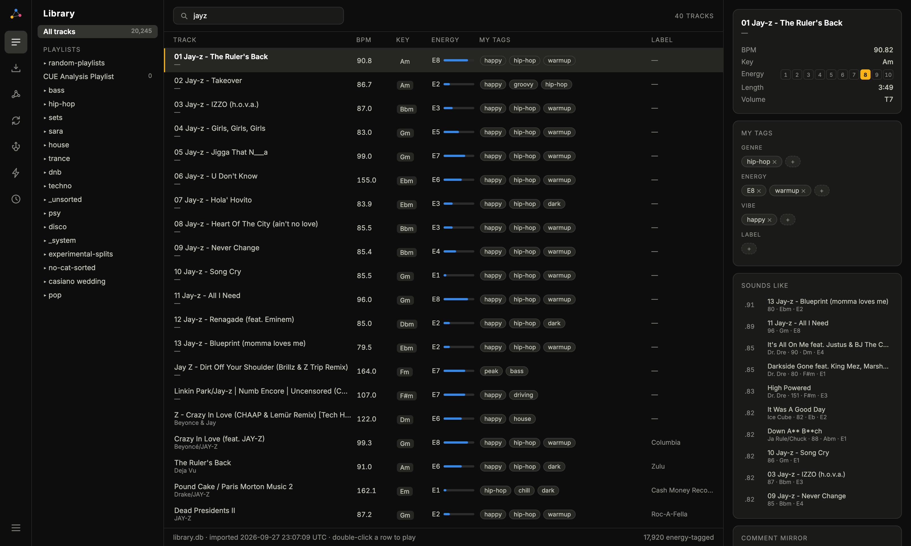

# Crate Constellation

One macOS app for the whole DJ library — ingest & analysis, editing, the
constellation similarity view, and diff-based sync to rekordbox, Traktor and
the XDJ-XZ stick.

**New here? Start with [docs/GUIDE.md](docs/GUIDE.md)** — setup, a tour of every
screen, and the rules that keep drives safe.

- Blueprint: https://claude.ai/code/artifact/e0702ab4-af6b-4f98-8d84-6f3446aac518
- Screen designs: https://claude.ai/code/artifact/37a8dc5f-0b47-4d53-a9f5-5b782766d986

## Status — MVP

Working screens over `library.db` (seeded from rekordbox master.db):

- **Library** — fuzzy search (jayz = jay-z), playlist tree, tag filters,
  detail pane with sounds-like neighbors, tag/energy **editing** (journaled,
  hashtag mirror kept), rekordbox ANLZ waveform player, right-click menu
- **Constellation** — 18.8k-point UMAP sound map, family-hue colors,
  zoom/pan/hover, click-select with neighbor edges, "open in constellation"
- **Energy & Tags** — E1–E10 histogram + 4 tag banks, click-to-browse
- **Sync** — per-target read state, net-change review of local edits,
  guarded re-import, Heal Library
- **USB stick** — read-only stick explorer, matching patch, sync wizard
- **Backups** — every on-disk snapshot (rekordbox/Traktor/stick), reveal

**USB sync is live and deck-verified** — the wizard builds fully playable
XDJ-XZ sticks with no rekordbox involved. See [SYNCING.md](SYNCING.md) for
how it works, the format rules, and maintenance. Writing sticks needs a local
template captured from one small rekordbox export; the app's Getting started
step does it for you.

Tests: `cd app && npx playwright test` (54 tests).

## Run

    ./setup.sh        # first time: install, build, start, open (Getting started walks you through the rest)

    ./run.sh import   # (re)seed library.db from rekordbox — read-only, safe anytime
    ./run.sh build    # build the frontend
    ./run.sh          # serve app + API at http://localhost:8765
    ./run.sh dev      # frontend hot reload on :5173 (engine on :8765)
    ./run.sh template /Volumes/X   # capture the stick-export template

## Layout

    engine/   FastAPI + importer + schema + device writers (Python, .venv)
    app/      React/TS frontend (Vite) + Playwright tests
    docs/     guide, format references, plans, screenshots
    .claude/  Claude Code skills for this repo (see CLAUDE.md)
    library.db, art-cache/, pdb-corpus/   local only (gitignored)
