# Crate Constellation: a guide for new people

Crate Constellation is a single macOS app for a DJ library. It reads your rekordbox
library into a database of its own (`library.db`). From there you can search, tag,
browse a sound map, and write **XDJ-XZ-ready USB sticks without rekordbox**.

This guide covers getting it running, finding your way around each screen, and the
handful of rules that keep your drives safe. For how sync works internally, read
[SYNCING.md](../SYNCING.md). For the analysis-file format, read
[ANLZ-FORMAT.md](ANLZ-FORMAT.md).

---

## 1. Setup

You need macOS, Python 3.12+ (3.14 recommended), Node 20+, and rekordbox 6 or 7 with a
library in it.

```sh
git clone <this repo> ~/Music/crate-constellation
cd ~/Music/crate-constellation
./setup.sh
```

`setup.sh` checks your tools, installs the engine and app dependencies, builds the app,
starts it, and opens <http://localhost:8765>. It is safe to re-run, and it never touches
rekordbox or any drive. Use `./setup.sh --no-open` to install without starting anything.

### Getting started (in the app)

On first launch the app opens **Getting started**, a four-step walkthrough. You can
reopen it any time from the **?** button at the bottom of the rail.

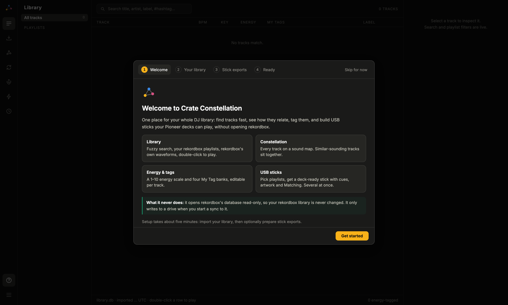

1. **Welcome:** what the app does, and what it never does.
2. **Your library:** imports your rekordbox library with one click. Importing reads
   rekordbox's `master.db` read-only, so it is safe with rekordbox open. It also shows
   whether the optional analysis data (below) is present.

   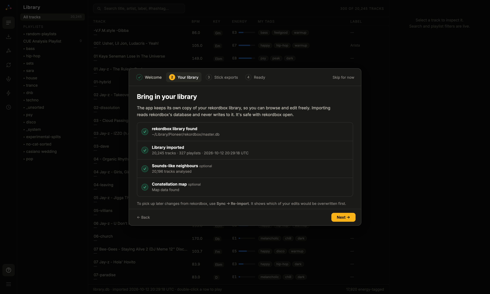

3. **Stick exports:** a short script that sets up stick writing (see the next section).
4. **Ready:** a few tips, then into your library, or straight to building a stick.

Later rekordbox changes come in through **Sync → Re-import**, which first shows which of
your local edits would be overwritten. `./run.sh import` does the same from a terminal.

### Stick exports: capturing the template

Decks are strict about the files on a stick. The USB writer therefore copies the
structure of a **genuine rekordbox export**: it clones the file header and each table's
head page, then fills in your tracks. That template is personal library data, so it is
**not in git**. Each install captures its own, once, into the gitignored `pdb-corpus/`.

The **Stick exports** step walks you through it:

1. Plug in a USB stick you can erase.
2. In rekordbox, switch to *Export* mode and drag one small playlist (3–5 tracks) onto
   the stick.
3. Leave it plugged in. The app lists it; click **Use this stick**.

   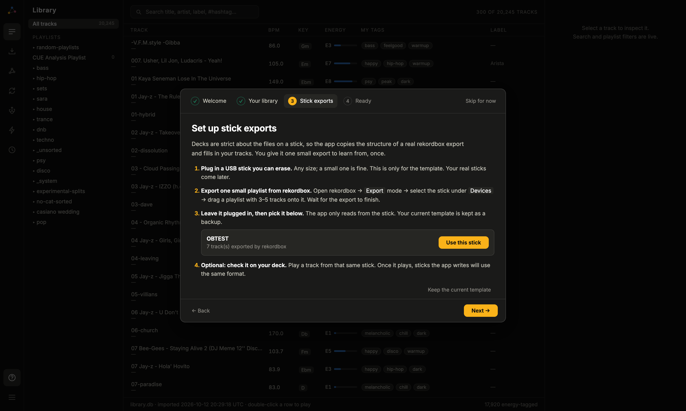

4. Optionally, play a track from that same stick on your deck and tick **It played**.

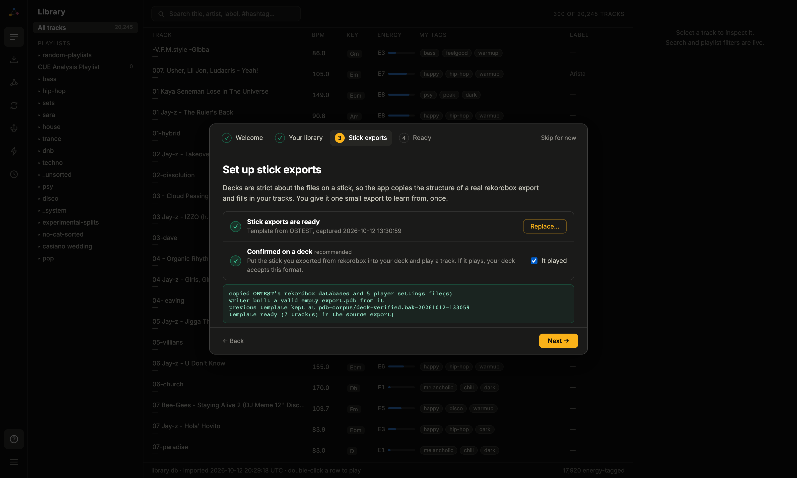

The capture **only reads** the stick. It refuses sticks that Crate Constellation wrote,
since the template must be rekordbox's own output. Before calling the template ready, it
checks that the writer can build a valid `export.pdb` from it. Replacing a template keeps
the old one as `pdb-corpus/deck-verified.bak-<time>`. From a terminal:

```sh
./run.sh template /Volumes/<STICK>            # add --replace to swap an existing one
```

Everything except writing sticks works without a template. Until there is one, the sync
wizard explains what's missing instead of starting.

### Optional data from `library-management`

Two features read data produced by the companion analysis pipeline in
`~/Music/library-management` (not part of this repo):

| Feature | Needs | Without it |
|---|---|---|
| "Sounds like" sidebar | `features_v2.sqlite` (discogs-effnet embeddings) | sidebar is empty |
| Constellation map | `viz_arrays.npz` + `viz_meta.csv` → `engine/import_viz.py` | map is empty |

---

## 2. A tour of the screens

The rail on the left switches screens. The right-hand pane always shows the selected
track.

### Library

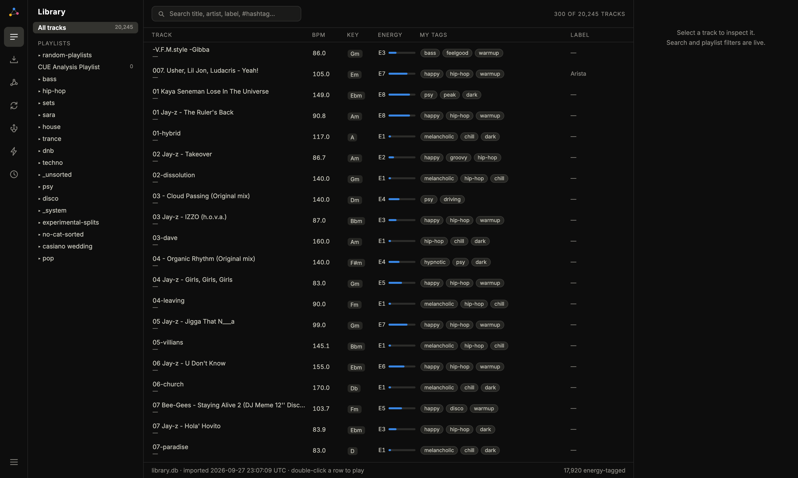

Your whole collection, with the rekordbox playlist tree on the left.

- **Search is fuzzy:** `jayz`, `jay-z` and `jay z` all match. It searches title, artist,
  album, label, comment and filename together.
- **Double-click a row to play it.** The waveform is rekordbox's own preview waveform,
  read from its analysis files. Click the waveform to seek.
- **Right-click** a row for more actions.


Selecting a track fills the detail pane:

- **Energy 1–10:** click a number to set it.
- **My Tags** in four banks: Genre, Energy, Vibe, Label. Edits are journaled and
  mirrored into the comment field as hashtags.
- **Sounds like:** nearest neighbours by audio embedding, with similarity scores.
  Click one to inspect it, double-click to play.

### Constellation

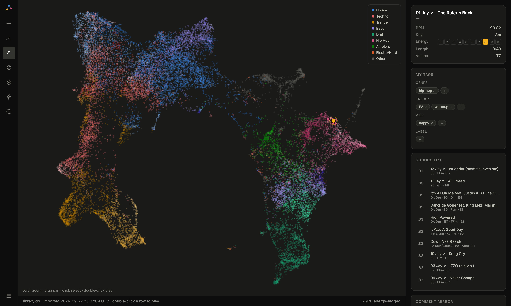

Every track as a point on a 2-D sound map. Colours are genre families; shades within a
colour are subgenres. Scroll to zoom, drag to pan, click to select (it draws edges to
the selected track's neighbours), double-click to play.

### Energy & Tags

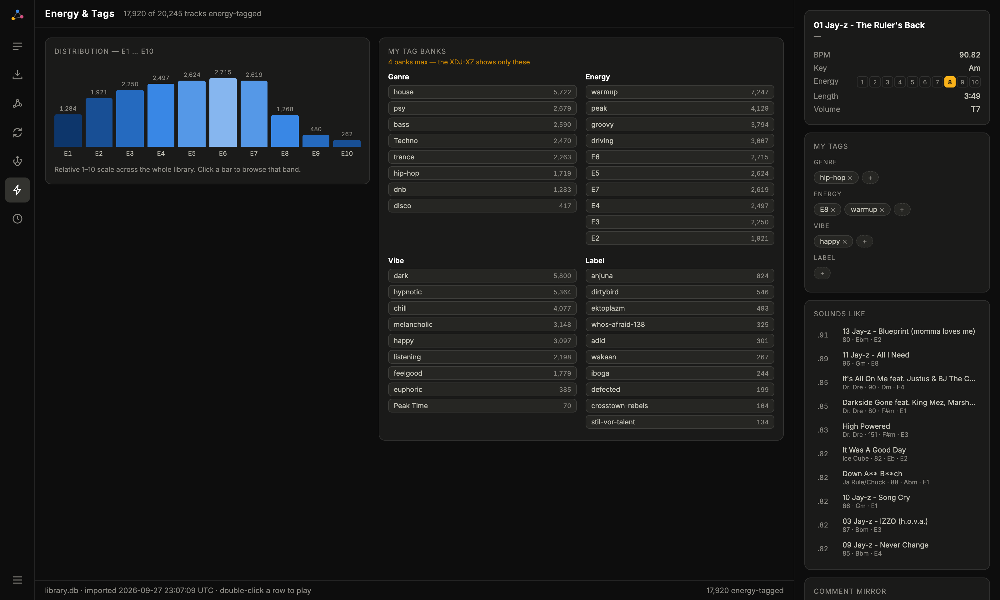

The E1–E10 histogram and all four tag banks. Click a bar or a tag chip to filter the
library to it. Energy is a *computed, relative* scale owned by one writer; don't
hand-add `warmup`/`peak`-style tags to the Energy bank.

### Sync

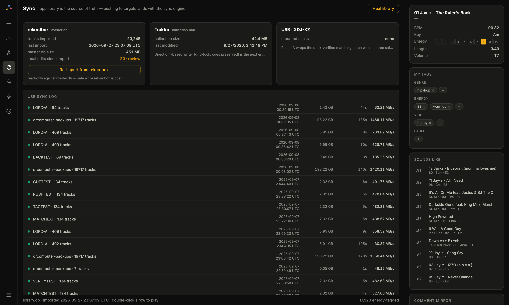

- **rekordbox / Traktor / USB cards** show the state of each target.
- **"N · review"** lists local edits since the last import, collapsed to net changes.
- **Heal library** is an idempotent repair pass: integrity check, missing files,
  orphaned links, energy-tag reconcile, comment-hashtag mirror. Running it twice
  fixes nothing the second time.
- **USB sync log** has one row per stick written, with size, time and throughput.

### USB stick

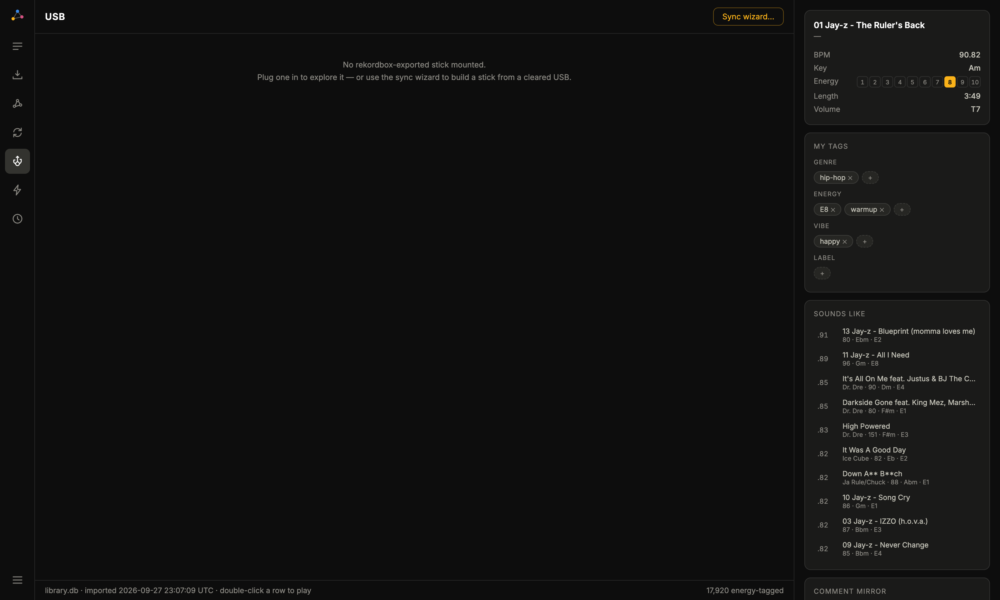

With a rekordbox stick mounted, this screen explores it. It copies the stick's
database off first and **never writes to the stick**. It diffs the stick against your
library: what's on it, what's missing, what's orphaned. **Patch matching** pushes the
full Matching (similar-tracks) table onto a stick that rekordbox exported.

**Sync wizard…** builds a stick from scratch:

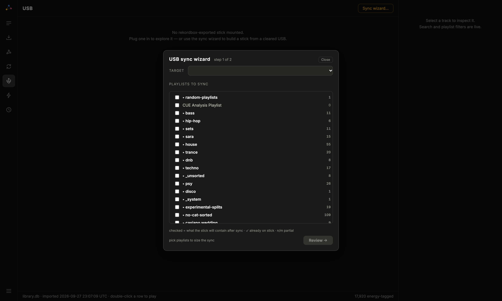

1. Pick a target drive and tick the playlists it should contain. Checked means "what
   the stick will hold after the sync".
2. Review, then start. The wizard closes, and a drawer on the right tracks progress,
   so the app stays usable. You can sync several sticks in parallel.

Each sync writes audio, analysis files with cues, `export.pdb` + `exportExt.pdb`,
OneLibrary and player settings. It then re-parses its own output as a verification
gate before calling the job done.

### Backups

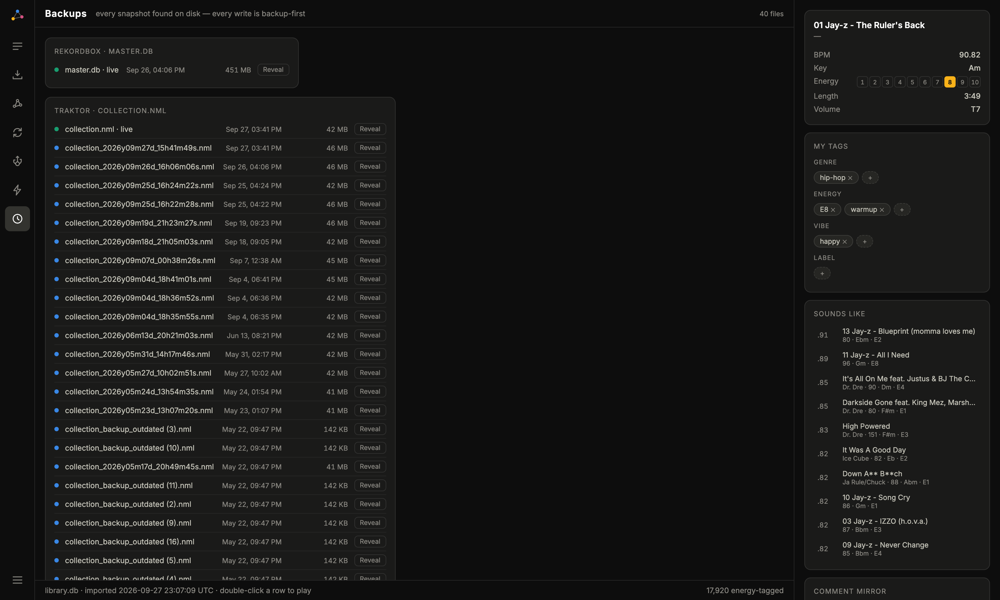

Every on-disk snapshot the app knows about: rekordbox `master.db` backups, Traktor
`collection.nml`, and stick backups taken before matching patches. "Reveal" opens one
in Finder.

---

## 3. Rules that keep drives safe

These rules exist because breaking them cost real data. Please follow them.

1. **Drive operations go through the app.** Sync, initialize and matching pushes run
   from the UI or its HTTP endpoints, never from ad-hoc scripts. A one-off script once
   replaced a 19,717-track drive with 7 tracks.
2. **Test on a sacrificial stick first.** Format changes get deck-tested on a throwaway
   stick before they touch a drive you rely on.
3. **Your source-of-truth SSD and its backup drives are not test targets.** The wizard
   offers them because you may choose them deliberately. Automation never should.
4. **New capabilities ship behind a setting, off by default.** With every flag off,
   a sync must produce the same bytes as the last known-good tag
   (`working-2026-09-07`).
5. **Beat grids are constant-tempo.** Tempo + first-beat offset + downbeat phase, never
   a per-beat tempo curve.

### When a stick misbehaves

| Symptom | Cause | Fix |
|---|---|---|
| Deck shows folder view only | DBs unreadable, or `PIONEER` vs `.PIONEER` wrong for the filesystem | HFS+ uses hidden `.PIONEER`, FAT32 uses `PIONEER`. Run `engine/verify_pdb.py` |
| Deck says "library corrupted" but the data checks clean | Deck-side cache | Power-cycle the deck |
| rekordbox crashes within ~25 s whenever the stick is mounted | Stale `sync.temp` markers from an interrupted export | With rekordbox closed, delete `sync.temp` / `sync.devlibplus.temp` / `._*` in `PIONEER/rekordbox/`. Leave the PDBs alone |
| rekordbox says it will "convert the library" | Nothing. It says this for its own exports too | Ignore it |
| Artwork missing on deck | Index-page first-data-page pointer (0x2C) stale | Fixed in the writer; `verify_pdb.py` checks it |

---

## 4. Developing

```sh
./run.sh dev                      # Vite hot reload on :5173, engine on :8765
cd app && npx playwright install chromium   # once, for the test browser
cd app && npx playwright test     # end-to-end tests against the running engine
```

- The engine always runs with `--reload`, so the code you click is the code on disk.
  Every sync records the build that wrote it (`/api/version`).
- USB tests auto-skip when no stick is mounted.
- Commit each finished feature on its own (code, tests and docs together).

### Where things live

```
engine/
  server.py            FastAPI app, all /api routes
  onboarding.py        first-run status + stick-export template capture
  import_rekordbox.py  master.db → library.db (read-only)
  schema.sql           library.db schema
  usb_sync.py          the sync wizard's job: audio, ANLZ, PDBs, OneLibrary, settings
  usb_init.py          initialize a drive the way rekordbox does
  pdb.py / pdb_writer.py  DeviceSQL (export.pdb) parser and from-scratch writer
  verify_pdb.py        structural checks every written PDB must pass
  anlz.py / cues.py    ANLZ tag walker and cue-container builder
  matching.py / push_matching.py  Matching table (exportExt type 0)
  heal.py              Heal Library + artwork cache
  diff_pdb.py, diff_onelibrary.py, compare_exports.py, dump_device.py  forensics
app/src/               React 19 + TypeScript UI (Vite); Onboarding.tsx = Getting started
app/tests/             Playwright specs
docs/                  format references and plans
```
